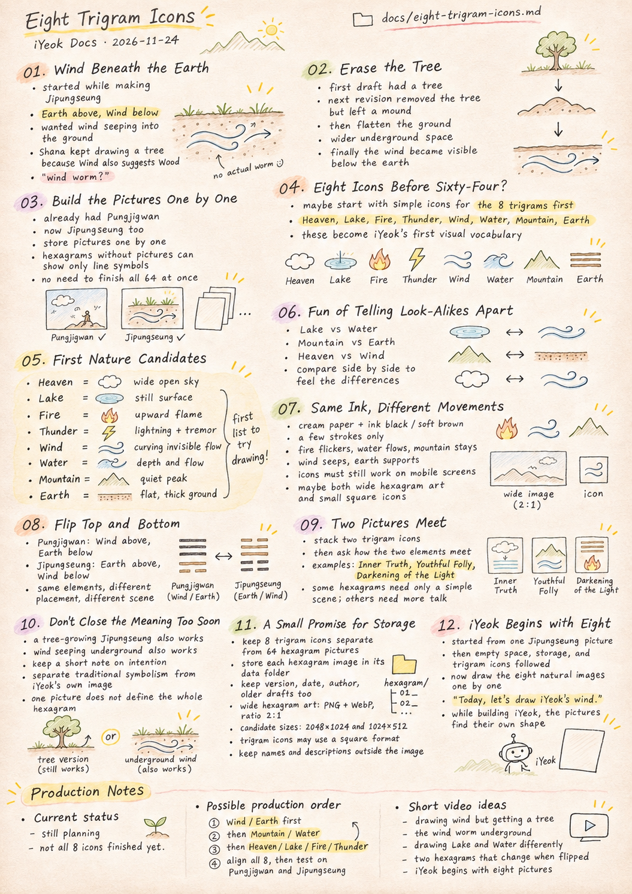
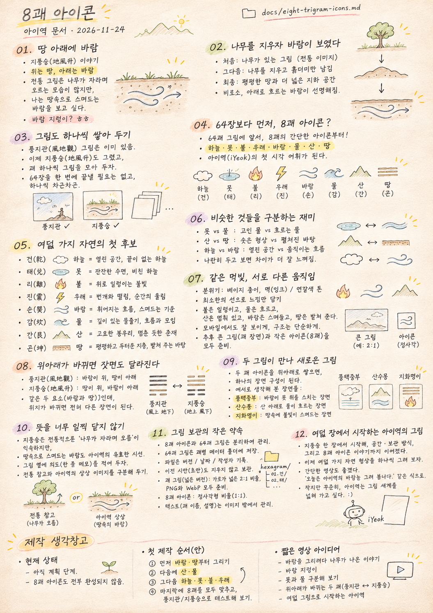

> Location: docs/eight-trigram-icons.md

# Eight Trigram Icons

iYeok Docs
Date: 2026-11-24

  

---

## 01. I Asked for Wind Beneath the Earth

I was making a picture of the hexagram *Jipungseung* for iYeok, my I Ching app, when I got stuck somewhere I didn't expect.

*Jipungseung* — known in English as "Pushing Upward" (䷭) — has Earth on top and Wind below.

I wanted to see wind seeping down under the ground. But Shana kept drawing a tree growing out of the soil.

She explained that the trigram for Wind also stands for Wood. And a tree rising from the middle of the earth is, in fact, the traditional image of this hexagram.

That made sense.

But it wasn't the picture in my head.

"What if the wind crawled into the ground — like an earthworm?"

As soon as I said it, I had to laugh.

A wind worm. Really.

Still, those words captured exactly what I was picturing.

> Image note  
> Cream background. Beneath a flat ground line, ink-dark wind winds its way down. No actual earthworm is drawn.

> Narration note  
> Start calm and plain. A small laugh at "A wind worm. Really." is fine.

## 02. Erase the Tree, and the Wind Appears

The first picture had a tree.

In the next one, the tree was gone — but a little mound had appeared.

I asked for the mound to go, too.

I wanted flat ground. I asked for more space underground, so the wind could drift around in there freely.

After a few rounds of edits, it finally came close to what I'd imagined.

Wind slipped through cracks in the ground and curled along in long waves. Some currents sank deep. Others rose back up near the surface.

That picture doesn't explain everything this hexagram means.

But through it, I could look at the relationship between earth and wind.

For a first picture, that was enough.

> Image note  
> Show three versions in order: the draft with a tree, the revision with a mound, and the final picture with wind moving through flat ground.

> Narration note  
> Follow the revisions slowly. It should feel like finding the picture together, step by step.

## 03. Pictures Can Pile Up One at a Time

iYeok already had a picture for *Pungjigwan* — "Contemplation" (䷓).

A simple ink drawing of wind passing over the ground.

Now there was one for *Jipungseung*, too.

So what if I made one picture each time a new hexagram came up?

Just as I'd written up the texts and commentary one by one, I could fill in the pictures by talking them through with Shana.

Talk about what scene comes to mind. Try drawing it. Fix whatever bothers me.

Then store the finished picture in that hexagram's data folder.

Later, when that hexagram comes up in iYeok, the app could pull up the picture and show it.

Hexagrams without a picture yet can just show their line symbol.

There's no need to finish all sixty-four at once.

> Image note  
> The two pictures sit side by side. Next to them, a loose row of blank sheets waiting to be filled.

> Narration note  
> Relaxed, like reading from a personal work journal. Leave a short pause after "all sixty-four at once."

## 04. Eight Pictures Before Sixty-Four?

While we were talking about where to store them, another idea popped up.

"What if we start with simple icons for the eight trigrams?"

Every six-line hexagram in the I Ching is made of two trigrams, one stacked on the other.

So why not draw the eight first: Heaven, Lake, Fire, Thunder, Wind, Water, Mountain and Earth.

If these eight basic pictures share a common feel, the sixty-four hexagrams will have a starting point.

I won't have to rethink "earth" from scratch every time.

I won't have to invent a brand-new line for "wind" every time.

Eight small pictures become iYeok's first visual vocabulary.

> Image note  
> Eight small boxes appear on an empty screen. Each holds only a trigram symbol and its name, for now.

> Narration note  
> A moment of a new idea arriving. Lightly stress "first visual vocabulary."

## 05. First Candidates for Eight Natural Images

Let's start with the easiest-to-recognize images from nature.

| Trigram | First image idea | Questions to keep in mind |
|---|---|---|
| Geon ☰ · Heaven | A wide, open space | Can it feel like sky without a lot of clouds? |
| Tae ☱ · Lake | Still, gathered water | How do we tell it apart from flowing water? |
| Ri ☲ · Fire | A flame flickering upward | Can a few strokes carry both warmth and movement? |
| Jin ☳ · Thunder | Lightning and spreading tremors | Can lightning and tremors make you think of thunder? |
| Son ☴ · Wind | Curving, continuous flow | What kind of line can show something invisible? |
| Gam ☵ · Water | A stream with depth | Can it show a flow and depth different from the lake? |
| Gan ☶ · Mountain | A quiet peak | Can one peak suggest stillness and weight? |
| Gon ☷ · Earth | Flat, thick layers of ground | Can it hold a wide, receiving feel — and still look different from the mountain? |

This table is just a first list of things to try drawing.

Out of each trigram's many symbols, I'm picking eight images from nature to start with.

Thunder is a sound, so lightning and tremors serve as visual cues that bring it to mind.

> Image note  
> Lay out the eight candidates as same-size cards. Symbol, name and picture shouldn't overlap.

> Narration note  
> Give each picture a moment to be seen. Pick questions from the table as needed during production.

## 06. The Fun of Telling Look-Alikes Apart

Once you start drawing, some of these look alike.

Lake and Water are both water.

Mountain and Earth are easy to draw with similar outlines.

Heaven and Wind both tend to become empty space.

So the eight need to be drawn separately, then placed side by side.

Lake can center on a still surface; Water on flow and depth.

Mountain can be a rising outline; Earth a broad, thick surface.

Heaven can get open space; Wind can get moving lines.

The differences can be small.

I just hope each one feels like its own character when they sit together.

> Image note  
> Compare in pairs: Lake and Water, Mountain and Earth, Heaven and Wind. Show differences in line and composition.

> Narration note  
> The voice of someone studying the pictures. Leave room for "this is one way to try it."

## 07. The Same Ink, Different Movements

I want iYeok's pictures to be simple and plain.

A cream background, with ink black or a soft brown.

Just a few strokes that show nature in motion.

Fire flickers. Water flows. Mountains stay.

Wind seeps in. Earth spreads out and holds.

Line weight, ink tone and empty space should match across all eight.

But each one's lines and composition should differ with its own nature.

I'll also check that they're recognizable on a small phone screen.

If we later need both small icons and wide hexagram pictures, we can keep the same feel and give each its own composition.

> Image note  
> Show the same icon large and small, side by side. Check which lines disappear when it shrinks.

> Narration note  
> Slow down a little when talking about paper, ink and empty space.

## 08. Flip Top and Bottom, and the Scene Changes

*Pungjigwan* and *Jipungseung* both have Earth and Wind.

But in different places.

*Pungjigwan* has Wind above and Earth below.

*Jipungseung* has Earth above and Wind below.

I'd like the pictures to show that difference.

In *Pungjigwan*, wind passes over the ground.

In the *Jipungseung* I pictured this time, wind seeps beneath it.

The same two elements, meeting in different places, make different scenes.

The trigram icons can be small tools for exploring that relationship.

> Image note  
> Swap the Earth and Wind icons top to bottom, then lead into the two hexagram pictures.

> Narration note  
> Say both hexagram names clearly. Pause briefly at the moment they swap.

## 09. When Two Pictures Meet and Become a New One

Stack two trigram icons, and you can see the basic structure.

Then think about how the two elements meet.

Does wind skim across a lake?

Does water spring up at the foot of a mountain?

Is fire hidden inside the earth?

These are scenes I could draw while thinking of three hexagrams: "Inner Truth" (*Pungtaek Jungbu*), "Youthful Folly" (*Sansu Mong*) and "Darkening of the Light" (*Jihwa Myeongi*).

The basic icons are a starting point. In each hexagram picture, I'll refine the scene where the two meet.

For some hexagrams, a simple arrangement will be enough.

Others will need more talking before the right picture comes out.

I'd like to work through that process with Shana.

> Image note  
> A sketching process, stacking two trigram icons. When using these three scenes, check and label each hexagram's name and its upper and lower trigrams.

> Narration note  
> Like a peek into the studio. Leave a short gap between the three scenes.

## 10. Don't Close a Picture's Meaning Too Soon

This *Jipungseung* picture taught me something.

Knowing the explanation can make drawing easier — but a familiar explanation can also make you miss another scene.

A *Jipungseung* with a growing tree works.

A *Jipungseung* with wind seeping underground can also stay — as my way of looking at how the two trigrams sit.

I'd like to write a short note beside each picture about what it was meant to show.

I also want to keep track of which parts draw on traditional symbolism, and which parts iYeok imagined anew.

No single picture can stand in for everything a hexagram means.

I just hope the picture helps me think again.

> Image note  
> Two different sketches of the same hexagram. Explain which follows traditional symbolism and which is iYeok's own composition.

> Narration note  
> Read as a personal reflection. Avoid sounding like it defines the whole I Ching.

## 11. A Small Promise for Keeping the Pictures

Before the pictures pile up, it would help to set some storage rules.

Keep the basic trigram icons separate from the hexagram pictures.

For each hexagram, I'm thinking of an image folder inside that hexagram's data folder.

Each finalized file records when it was made and by whom.

Earlier versions are kept, too.

For wide hexagram pictures, we discussed a 2:1 ratio, with a PNG for archiving and a WebP for the website.

The candidate sizes are 2048×1024 pixels for the archive and 1024×512 for the website.

For the trigram icons, it would be good to consider a separate square format so all eight look the same size.

Hexagram names and descriptions stay out of the picture and are shown on screen instead.

That makes it easier to fix the text or show it in other languages.

I'd also like to record each picture's intent, its alt text and its file path.

> Image note  
> Show two simple collections: one for trigram icons, one for the 64 hexagram pictures. Keep any file-management screen brief.

> Narration note  
> Make it clear that the formats under review are still proposals.

## 12. iYeok's Pictures Begin with Eight

At first, I only asked for one picture of *Jipungseung*.

Fixing it led us to talk about empty space. Talking about storage led us to the trigram icons.

Now I'd like to draw the eight natural images, one by one.

Find lines I like. Tell the look-alikes apart. Let two pictures meet.

That process could become short videos, too.

"Today, let's draw iYeok's wind."

That one line might be all it takes to begin.

While I build the iYeok I want to use, its pictures will slowly find their own shape.

> Image note  
> Drafts of the eight icons appear one after another. End with a small iYeok name and one blank sheet, still in progress.

> Narration note  
> A relaxed voice, looking forward to the next piece of work. End with a short laugh and a pause.

---

## Production Notes

### Current status

- This is a revised draft of the plan and video script for the trigram icons.
- It doesn't mean all eight icons are finished.
- Storage locations and image formats include ideas that are still proposals.
- Any lines that don't match the pictures once they're made will be revised.

### Possible production order

1. Start with Wind and Earth, which we've already discussed.
2. Add Mountain and Water, and compare the four side by side.
3. Add Heaven, Lake, Fire and Thunder.
4. Align lines and spacing across all eight icons.
5. Try them out on *Pungjigwan* and *Jipungseung*.

### Short video ideas

- Trying to draw wind, and getting a tree
- The wind worm wandering underground
- Drawing Lake and Water differently
- Two hexagrams that change when you flip them
- iYeok begins with eight pictures

### Notes on this English version

- Keeps the first-person voice and light humor of the Korean original.
- Keeps chapter numbers and the image/narration note structure.
- Korean wordplay is reworked so it lands for English listeners.
- Separates traditional trigram symbolism from iYeok's own creative images.
- Proposals stay proposals; nothing under review is described as finished.
- Sentences are kept short for easy narration.
- No historical background or claims beyond the original have been added.

---

*iYeok Docs*

This document was prepared with the assistance of Shana (GPT) and Laude (Claude).

---
 
 

# 8괘 아이콘

아이역 문서
작성일: 2026-11-24

  

---

## 01. 땅 아래에 바람을 그려 달라고 했다

아이역에 넣을 지풍승 그림을 만들다가 생각하지 못한 곳에서 멈췄다.

지풍승은 위에 땅이 있고, 아래에 바람이 있는 괘다.

나는 땅 아래로 바람이 스며드는 모습을 보고 싶었다. 그런데 샤나는 자꾸 땅에서 자라는 나무를 그렸다.

손괘에는 바람뿐 아니라 나무의 상징도 있다고 했다. 땅 가운데 나무가 자라는 모습은 승괘의 전통적인 상징이기도 하다.

그 설명은 이해했다.

그런데 내가 보고 싶었던 그림은 조금 달랐다.

“바람이 지렁이처럼 땅속으로 들어가면 어떨까?”

말을 꺼내고 보니 조금 우스웠다.

바람 지렁이라니.

그래도 그 말이 내가 떠올린 모습을 가장 잘 전해 줬다.

> 이미지 메모  
> 미색 바탕. 평평한 지표 아래로 먹빛 바람이 구불구불 스며든다. 실제 지렁이를 그리지는 않는다.

> 나레이션 메모  
> 처음에는 담담하게. “바람 지렁이라니”에서 잠깐 웃어도 좋다.

## 02. 나무를 지우자 바람이 보였다

처음 그림에는 나무가 있었다.

다음 그림에서는 나무가 사라지고 둔덕이 생겼다.

나는 둔덕도 지워 달라고 했다.

평평한 땅이면 좋겠다고 했다. 땅속 공간을 조금 더 넓히고, 바람이 그 안에서 여유롭게 오가면 좋겠다고 했다.

몇 번 고치고 나니 비로소 내가 생각한 모습에 가까워졌다.

땅의 틈으로 들어간 바람이 길게 굽이쳤다. 어떤 흐름은 깊이 내려갔고, 어떤 흐름은 다시 지표 가까이 올라왔다.

그 그림이 지풍승의 모든 뜻을 설명하는 것은 아니다.

다만 나는 그 그림을 통해 땅과 바람의 관계를 바라볼 수 있었다.

그 정도면 첫 그림으로 충분했다.

> 이미지 메모  
> 나무가 있는 초안, 둔덕이 있는 수정안, 평평한 땅속을 바람이 오가는 그림을 순서대로 보여 준다.

> 나레이션 메모  
> 수정 과정을 천천히 따라간다. 원하는 모습을 함께 찾아가는 느낌으로 읽는다.

## 03. 그림도 하나씩 쌓아 두면 되겠다

아이역에는 이미 풍지관 그림이 있었다.

땅 위로 바람이 지나가는 담백한 먹빛 그림이었다.

이번에는 지풍승 그림이 생겼다.

그렇다면 앞으로 괘가 나올 때마다 그림을 하나씩 만들어 두면 어떨까?

괘사와 해설을 하나씩 정리했듯이, 그림도 샤나와 이야기하며 채워 가는 것이다.

어떤 장면이 떠오르는지 이야기하고, 그려 보고, 마음에 걸리는 부분을 고친다.

그렇게 확정한 그림을 해당 괘의 데이터 폴더에 보관한다.

나중에 아이역에서 그 괘가 나오면, 준비해 둔 그림을 불러와 함께 보여 줄 수 있을 것이다.

아직 그림이 없는 괘는 괘상만 보여 주면 된다.

예순네 장을 한꺼번에 완성할 필요는 없다.

> 이미지 메모  
> 풍지관과 지풍승 그림 두 장이 나란히 놓인다. 그 옆에는 앞으로 채울 빈 종이들이 이어진다.

> 나레이션 메모  
> 개인 작업 노트를 읽듯 편안하게. “한꺼번에 완성할 필요는 없다” 뒤에 짧은 여백.

## 04. 예순네 그림보다 여덟 그림이 먼저일까

그렇게 저장할 곳을 이야기하다가 생각이 하나 더 떠올랐다.

“팔괘의 간단한 아이콘부터 만들어 두면 어떨까?”

주역의 육효괘는 팔괘 두 개가 위아래로 만난다.

그렇다면 하늘, 못, 불, 우레, 바람, 물, 산, 땅을 먼저 그려 두는 것이다.

여덟 가지 기본 그림에 공통된 분위기가 있으면, 예순네 괘를 그릴 때도 출발점이 생긴다.

땅을 표현할 때마다 처음부터 고민하지 않아도 된다.

바람을 그릴 때마다 전혀 다른 선을 만들지 않아도 된다.

작은 그림 여덟 개가 아이역 그림의 첫 어휘가 되는 셈이다.

> 이미지 메모  
> 빈 화면에 여덟 개의 작은 칸이 나타난다. 각 칸에는 팔괘 기호와 이름만 먼저 놓인다.

> 나레이션 메모  
> 새로운 생각이 떠오르는 장면. “첫 어휘”는 가볍게 강조한다.

## 05. 여덟 가지 자연의 첫 후보

우선은 가장 알아보기 쉬운 자연의 모습부터 생각해 본다.

| 팔괘 | 첫 이미지 후보 | 표현할 때 생각할 점 |
|---|---|---|
| 건 ☰ · 하늘 | 넓게 열린 공간 | 구름을 많이 넣지 않고도 하늘이 느껴질까? |
| 태 ☱ · 못 | 잔잔하게 고인 수면 | 흐르는 물과 어떻게 구분할까? |
| 리 ☲ · 불 | 위로 일렁이는 불꽃 | 적은 획으로 따뜻함과 움직임을 담을 수 있을까? |
| 진 ☳ · 우레 | 번개와 퍼지는 떨림 | 번개와 떨림으로 우레를 떠올리게 할 수 있을까? |
| 손 ☴ · 바람 | 휘어지고 이어지는 흐름 | 눈에 보이지 않는 바람을 어떤 선으로 그릴까? |
| 감 ☵ · 물 | 깊이를 가진 물줄기 | 못과 다른 흐름과 깊이를 보여 줄 수 있을까? |
| 간 ☶ · 산 | 고요한 봉우리 | 봉우리 하나로 멈춤과 무게가 느껴질까? |
| 곤 ☷ · 땅 | 평평하고 두터운 지층 | 산과 구별하면서 받아 주는 넓이를 담을 수 있을까? |

이 표는 그려 보기 위한 첫 후보 목록이다.

팔괘의 여러 상징 가운데 자연의 모습 여덟 가지를 먼저 골라 보는 것이다.

우레는 소리이므로, 번개와 떨림을 눈으로 떠올릴 수 있는 단서로 생각해 본다.

> 이미지 메모  
> 여덟 후보를 같은 크기의 카드로 배치한다. 기호, 이름, 그림이 서로 가리지 않게 한다.

> 나레이션 메모  
> 각 그림을 한 번씩 바라볼 시간을 준다. 표의 질문은 제작 과정에서 골라 사용한다.

## 06. 비슷한 것들을 구분하는 재미

막상 그리려면 비슷해 보이는 것들이 있다.

못과 물은 모두 물이다.

산과 땅은 비슷한 윤곽으로 그려지기 쉽다.

하늘과 바람은 둘 다 빈 공간으로 표현되기 쉽다.

그래서 여덟 그림을 따로 그린 뒤 한자리에 놓아 봐야 한다.

못은 고인 수면을 중심으로, 물은 흐름과 깊이를 중심으로 그려 볼 수 있다.

산은 솟은 윤곽으로, 땅은 넓고 두터운 면으로 구분해 볼 수 있다.

하늘에는 열린 여백을 주고, 바람에는 움직이는 선을 줄 수도 있다.

이런 차이가 작아도 괜찮다.

나란히 보았을 때 서로 다른 성격이 느껴지면 좋겠다.

> 이미지 메모  
> 못과 물, 산과 땅, 하늘과 바람을 두 개씩 비교한다. 선과 구도의 차이를 보여 준다.

> 나레이션 메모  
> 그림을 관찰하는 말투. “이렇게 해 볼 수 있다”는 여지를 둔다.

## 07. 같은 먹빛, 서로 다른 움직임

아이역의 그림은 담백했으면 좋겠다.

미색 바탕에 먹빛이나 옅은 갈색.

몇 획으로 자연의 움직임이 보이면 좋겠다.

불은 일렁이고, 물은 흐르고, 산은 머무른다.

바람은 스며들고, 땅은 넓게 받친다.

여덟 그림의 선 굵기와 농담, 여백은 서로 어울리게 맞춘다.

각 자연의 성격에 따라 선과 구도에는 차이를 둔다.

작은 모바일 화면에서도 알아볼 수 있는지 함께 살펴본다.

나중에 작은 아이콘과 넓은 괘 그림이 모두 필요해지면, 같은 분위기를 유지하면서 각각에 맞는 구도를 만들면 될 것이다.

> 이미지 메모  
> 같은 아이콘을 큰 크기와 작은 크기로 나란히 보여 준다. 축소했을 때 사라지는 선을 확인한다.

> 나레이션 메모  
> 종이, 먹, 여백을 이야기하는 부분은 조금 느리게 읽는다.

## 08. 위아래가 바뀌면 장면도 달라진다

풍지관과 지풍승에는 모두 땅과 바람이 있다.

하지만 위치가 다르다.

풍지관은 위에 바람, 아래에 땅이 있다.

지풍승은 위에 땅, 아래에 바람이 있다.

그 차이를 그림에서도 느낄 수 있으면 좋겠다.

풍지관에서는 바람이 땅 위를 지나간다.

이번에 내가 떠올린 지풍승에서는 바람이 땅 아래로 스며든다.

같은 두 가지 자연이 만나도, 놓이는 자리에 따라 장면이 달라진다.

팔괘 아이콘은 그 관계를 살펴보는 작은 재료가 될 수 있다.

> 이미지 메모  
> 땅과 바람 아이콘의 위아래를 바꿔 보여 준 뒤, 각각 풍지관과 지풍승 그림으로 이어진다.

> 나레이션 메모  
> 두 괘의 이름을 또렷하게 읽고, 위치가 바뀌는 순간에 잠깐 멈춘다.

## 09. 두 그림이 만나 새로운 그림이 되는 과정

팔괘 아이콘 두 개를 위아래로 놓으면 기본 구성을 확인할 수 있다.

그다음에는 두 자연이 어떻게 만나는지 생각해 본다.

바람이 못 위를 스치는가.

물이 산 아래에서 솟아나는가.

불이 땅속에 감추어져 있는가.

각각 풍택중부, 산수몽, 지화명이를 떠올리며 그려 볼 수 있는 장면이다.

기본 아이콘은 출발점으로 사용하고, 괘 그림에서는 두 요소가 만나는 장면을 다듬는다.

어떤 괘는 아주 단순한 배치만으로도 충분할 것이다.

어떤 괘는 조금 더 이야기해야 원하는 모습이 나올 것이다.

나는 그 과정을 샤나와 함께 해 보고 싶다.

> 이미지 메모  
> 팔괘 아이콘 두 장을 위아래로 배치해 보는 스케치 과정. 세 장면을 사용할 때는 각각 풍택중부·산수몽·지화명이의 이름과 상괘·하괘를 확인해 함께 표시한다.

> 나레이션 메모  
> 작업실을 보여 주는 느낌. 세 장면 사이에 짧은 간격을 둔다.

## 10. 그림의 뜻을 너무 일찍 닫지 않기

이번 지풍승 그림에서 내가 배운 것이 있다.

설명을 알고 있으면 그림을 그리기 쉬워질 때도 있지만, 익숙한 설명 때문에 다른 장면을 놓칠 때도 있다는 것이다.

나무가 자라는 지풍승도 가능하다.

땅속으로 바람이 스며드는 지풍승도, 내가 괘의 위아래 관계를 바라보는 그림으로 남길 수 있다.

그림 옆에는 어떤 의도로 만들었는지 짧게 적어 두면 좋겠다.

전통적인 상징을 참고한 부분과, 아이역에서 새롭게 상상한 부분도 구분해 두고 싶다.

그림 한 장이 괘의 모든 뜻을 대신하지는 않는다.

나는 그 그림을 보며 다시 생각할 수 있으면 좋겠다.

> 이미지 메모  
> 같은 지풍승을 바라보는 서로 다른 스케치 두 장. 전통 상징을 참고한 그림과 아이역의 창작 구도를 구분해 설명한다.

> 나레이션 메모  
> 개인적인 생각으로 읽는다. 주역 전체를 정의하는 어조는 피한다.

## 11. 그림을 보관하는 작은 약속

그림이 늘어나기 전에 보관 규칙도 정해 두면 좋겠다.

팔괘의 기본 아이콘과 각 괘의 그림은 구분해서 모은다.

각 괘의 그림은 해당 괘의 데이터 폴더 안에 이미지 폴더를 두어 보관하는 방향을 생각하고 있다.

확정한 파일에는 작성 시점과 작성자를 남긴다.

수정 전 그림도 보존한다.

넓은 괘 그림은 가로세로 2:1 비율을 기준으로 삼고, 보관용 PNG와 홈페이지용 WebP를 준비하는 안을 이야기했다.

보관용은 2048×1024픽셀, 홈페이지용은 1024×512픽셀을 후보 규격으로 두었다.

팔괘 아이콘은 여덟 개가 같은 크기로 보이도록 별도의 정사각형 규격을 검토하면 좋겠다.

괘 이름과 설명은 그림 안에 넣지 않고 화면에서 따로 표시한다.

그러면 글씨를 고치거나 다른 언어로 보여 주기도 편할 것이다.

그림의 의도와 대체 설명, 사용할 파일 경로도 함께 기록해 두고 싶다.

> 이미지 메모  
> 팔괘 아이콘 보관함과 64괘 그림 보관함을 두 묶음으로 표현한다. 파일 관리 화면은 짧게만 보여 준다.

> 나레이션 메모  
> 아직 검토 중인 규격은 제안이라는 점이 드러나게 읽는다.

## 12. 여덟 장에서 시작하는 아이역의 그림

처음에는 지풍승 그림 한 장을 부탁했다.

그림을 고치다 보니 여백을 이야기하게 되었고, 저장할 곳을 이야기하다 보니 팔괘 아이콘까지 생각하게 되었다.

이제 여덟 가지 자연을 하나씩 그려 보면 좋겠다.

마음에 드는 선을 찾고, 서로 닮은 그림들을 구분하고, 두 그림을 만나게 해 보는 것이다.

그 과정은 짧은 영상으로도 남길 수 있겠다.

“오늘은 아이역의 바람을 그려 봅니다.”

그 한마디로 시작해도 충분할 것 같다.

내가 편하게 쓰고 싶은 아이역을 만드는 동안, 그림도 조금씩 자기 모습을 찾아갈 것이다.

> 이미지 메모  
> 여덟 아이콘의 초안이 차례로 놓인다. 마지막에는 작은 아이역 이름과 함께 작업 중인 빈 종이 한 장을 남긴다.

> 나레이션 메모  
> 다음 작업을 기대하는 편안한 목소리. 끝에 짧은 웃음과 여백.

---

## 제작 생각창고

### 문서의 현재 상태

- 팔괘 아이콘을 만들기 위한 구상과 영상 대본의 한글 수정본이다.
- 아이콘 여덟 장이 이미 완성되었다는 뜻은 아니다.
- 보관 위치와 이미지 규격에는 아직 제안 단계인 내용이 포함되어 있다.
- 실제 제작 후 그림과 맞지 않는 문장은 수정한다.

### 첫 제작 순서 후보

1. 이미 이야기한 바람과 땅부터 그린다.
2. 산과 물을 더해 네 가지를 나란히 비교한다.
3. 하늘, 못, 불, 우레를 추가한다.
4. 여덟 아이콘의 선과 여백을 맞춘다.
5. 풍지관과 지풍승에 적용해 본다.

### 짧은 영상 후보

- 바람을 그리려다 나무가 나온 이야기
- 땅속을 오가는 바람 지렁이
- 못과 물을 다르게 그리는 방법
- 위아래를 바꾸면 달라지는 두 괘
- 여덟 그림으로 시작하는 아이역

### 영문판 작성 기준

- 한국어 원문의 1인칭 시점과 편안한 유머를 살린다.
- 장 번호와 이미지·나레이션 메모 구조를 유지한다.
- 한국어 말장난은 영어로 들었을 때 이해되는 표현으로 다듬는다.
- 팔괘의 자연 상징과 아이역의 창작 이미지를 구분한다.
- 아직 제안하거나 검토 중인 내용을 완성된 기능처럼 바꾸지 않는다.
- 영상 나레이션으로 읽기 편하도록 문장을 짧고 자연스럽게 나눈다.
- 문서에 없는 역사적 설명이나 효능을 추가하지 않는다.

---

*아이역 문서*

이 문서는 샤나(GPT)와 로드(Claude)의 도움을 받아 작성되었습니다.
