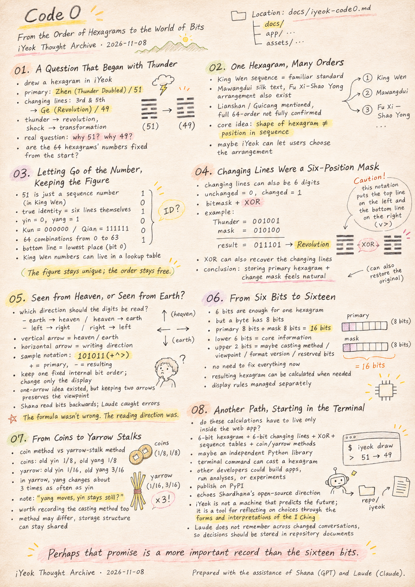
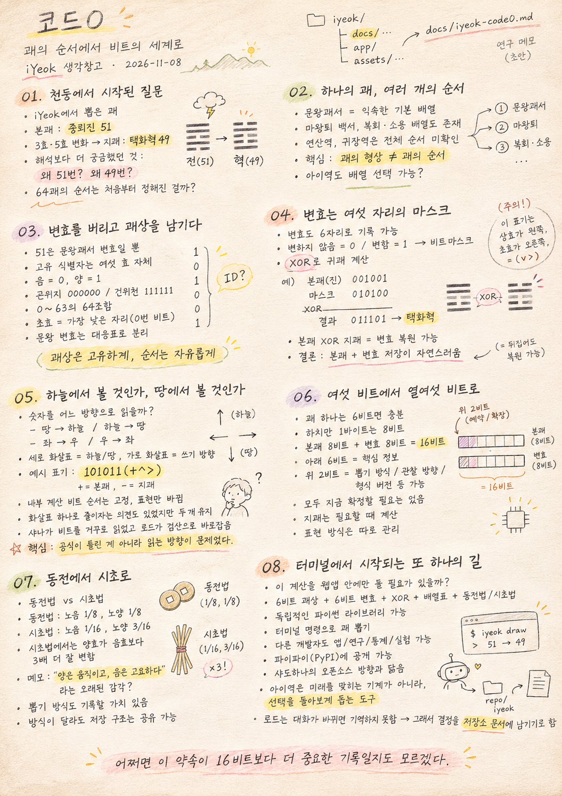

> Location: `docs/iyeok-code0.md`

# Code 0

**From the Order of Hexagrams to the World of Bits**

(iYeok Thought Archive · 2026-11-08)

## 🎬 YouTube Video

[Watch on YouTube](https://youtu.be/cUl9v_pkegw)

  

---

## 01. A Question That Began with Thunder

I drew a hexagram in iYeok.

The primary hexagram was Zhen, "Thunder Doubled" — Hexagram 51.

Thunder above, thunder below. Two of its six lines, the third and the fifth, were changing lines, and so the resulting hexagram became Ge, "Revolution" — Hexagram 49, lake over fire.

From thunder to revolution.

A figure that moves from shock into transformation.

But what caught my attention was not the reading.

Why is Thunder number 51, and Revolution number 49?

The 64 hexagrams of the I Ching begin with Qian, "The Creative," and end with Weiji, "Before Completion." I wondered whether that order had been fixed from the very beginning.

Every hexagram is simply a combination of six lines, each either yin or yang.

If so, isn't the order in which those 64 combinations are listed a separate question altogether?

A small question had begun.

---

## 02. One Hexagram, Many Orders

The I Ching has long used what is known as the King Wen sequence.

It places Qian, Heaven, first and Kun, Earth, second, and it ends with Weiji, Hexagram 64.

But it is not the only arrangement.

The silk manuscript of the I Ching excavated at Mawangdui preserves a different order. There is also the Fu Xi "Earlier Heaven" arrangement, systematized by Shao Yong in the Song dynasty.

Tradition also speaks of two other versions of the classic, the Lianshan and the Guicang. Their complete sequences of 64 hexagrams, however, cannot be fully confirmed today.

This drew a clear line between two things.

The shape of a hexagram and its position in a sequence are not the same.

The figure formed by six lines stays what it is, while the way those figures are arranged can differ.

Then why not let iYeok users choose the arrangement?

King Wen as the default, with the Mawangdui and Fu Xi–Shao Yong orders as options.

At first it looked like nothing more than adding a setting.

But changing the order forced me to rethink what a hexagram's number really means.

---

## 03. Letting Go of the Number, Keeping the Figure

Does the number 51 mean Thunder itself?

In the King Wen sequence, yes.

Change the arrangement, though, and the same hexagram gets a different number.

So what should a hexagram's true identity be?

The answer is to write the six lines down directly as a number.

Yin becomes 0. Yang becomes 1.

Six positions give 2 to the 6th power — exactly 64 combinations.

Kun, Earth, is 000000. Qian, Heaven, is 111111.

In decimal, they run from 0 to 63.

At that point, the binary numbers of computing — long familiar to me — came to mind.

The yin and yang of the I Ching, and the 0 and 1 of the computer.

They come from very different eras, yet both are built on the same mathematics: combinations of two states.

The Fu Xi–Shao Yong arrangement can likewise be explained in binary terms.

Still, a traditional arrangement does not necessarily assign its positions the way a computer assigns bits.

For iYeok, we decided that the bottom line would be the lowest bit, bit 0.

The King Wen numbers can then live in a separate lookup table.

The figure stays unique; the order stays free.

The structure was starting to get simpler.

---

## 04. Changing Lines Were a Six-Position Mask

Once hexagrams became binary numbers, the next question appeared.

How should the changing lines be recorded?

In the I Ching, a single line may change, or several may change at once.

What if their positions were written as another six-digit binary number?

A line that stays the same is 0.

A line that changes is 1.

This is exactly what programmers call a bitmask.

And here an operation called XOR — "exclusive or" — entered the picture.

XOR gives 1 only when two bits differ.

Apply XOR to a hexagram and its mask, and only the lines marked as changing flip between yin and yang.

Thunder, for example, is 001001.

If the third and fifth lines change, the mask is 010100.

XOR the two, and you get 011101.

That is Revolution.

All of these binary strings are written with the top line on the left and the bottom line on the right. They follow the internal rule that the bottom line is the lowest bit; in the notation introduced in Chapter 05, this is `(v>)`.

Even more interesting, the calculation runs in reverse.

XOR the primary hexagram with the resulting one, and you recover exactly which lines changed.

The primary hexagram and its mask.

Or the primary hexagram and its result.

Either pair holds all the information needed.

Still, storing the primary hexagram together with its mask felt more natural, because it records directly where the change happened.

---

## 05. Seen from Heaven, or Seen from Earth?

Writing hexagrams in binary raised yet another question.

In which direction should the six digits be read?

The lines of a hexagram are counted from the bottom up.

They begin at the first line and rise to the top.

But an ordinary binary number puts its highest digit on the left.

Add the direction of writing itself, and the picture changes again.

Read from earth up to heaven?

Or from heaven down to earth?

Write from left to right?

Or from right to left?

I decided to attach a few small symbols.

The vertical arrow stands for heaven and earth; the horizontal arrow stands for the direction of writing.

101011(+^>)

Three symbols follow the six digits.

`+` marks the primary hexagram.

`^` is the view from earth looking up to heaven.

`>` means the digits are written from left to right.

For the resulting hexagram, we chose `-`.

For example: 111010(-^>).

Of course, the same figure produces a different string of digits when it is written in a different direction.

So we arrived at this idea: keep a single, fixed bit order for all internal calculation, and apply the user's chosen viewpoint only when the hexagram is displayed.

Someone suggested reducing the two arrows to one. But even when the digits come out the same, a person building upward from the earth and a person looking down from heaven are standing in different places. To preserve that viewpoint, we kept both arrows.

Along the way, Shana read the bits backwards more than once. Laude caught the errors while double-checking the math.

The formula was never wrong. The direction in which the bits were read was.

And that very mistake became the reason to record direction explicitly.

---

## 06. From Six Bits to Sixteen

Six bits are enough to describe a hexagram.

But the byte, the basic unit computers work with, has eight.

Couldn't the two spare bits carry some meaning?

At first we thought of using them to mark primary versus resulting hexagram, or heaven versus earth.

But once we decided to store the primary hexagram and the changing-line mask in a byte each, the structure shifted again.

Eight bits for the primary hexagram.

Eight bits for the changing-line mask.

Sixteen bits in total — two bytes.

In each byte, the lower six bits hold the essential information.

The upper two bits are still open.

Laude suggested they could record how the hexagram was cast, the viewing direction, or a format version.

Not every position has to be decided now.

Given that new features may come along, leaving some bits in reserve is a choice in itself.

What mattered was this: these sixteen bits could become a small format that preserves the essence of a reading.

Store the primary hexagram and its changing lines.

Calculate the resulting hexagram when it's needed.

Handle how things look on screen separately.

Problems that had seemed tangled were slowly coming apart.

---

## 07. From Coins to Yarrow Stalks: A Difference in Probability

We had been thinking of the coin method as iYeok's way of casting hexagrams.

Three coins produce one line, and the process is repeated six times.

But the I Ching also has an older, traditional method that uses yarrow stalks.

Laude pointed out how the two differ.

With coins, old yin and old yang — the changing lines — each appear with a probability of 1 in 8.

The idealized probabilities of the traditional yarrow-stalk method are different.

Old yin: 1 in 16.

Old yang: 3 in 16.

With yarrow stalks, a yang line is three times as likely to change as a yin line.

It is as if the ancient idea that yang moves while yin stays still had been written straight into the odds.

A fascinating difference.

Both methods produce figures of yin and yang, but change is not distributed the same way.

So the casting method itself is worth recording.

Was it cast with coins?

Or with yarrow stalks?

Other methods may appear later.

Yet whatever the method, the final result is always six lines plus a set of changing lines.

So the casting method can vary while the storage format stays shared.

The probabilities differ; the underlying structure of the data does not.

We decided to work out the yarrow-stalk implementation later.

For today, discovering the possibility was enough.

---

## 08. Another Path, Starting in the Terminal

Having come this far, a new possibility opened up.

Did all of these calculations really need to live only inside the iYeok web app?

Six bits for the hexagram.

Six bits for the changing lines.

The XOR operation.

Lookup tables for each arrangement.

The coin method and the yarrow-stalk method.

What if they became an independent Python library?

A single short command in the terminal could cast a hexagram.

Other developers could build their own I Ching programs on top of it.

Some might design new interfaces; others might run statistical analyses.

Others still might study the old divination methods, or experiment with new arrangements.

Published on PyPI, Python's package index, it would become something anyone using Python could install.

Of course, there's no telling who would actually use it.

Perhaps no one would care at all.

But a small tool released into the open always carries the chance of turning into something entirely unexpected in someone else's hands.

This echoed the open-source direction we had imagined for Shardhana.

The core stands on its own.

The interface sits on top of it.

A person can use it directly, or another program can call it.

And anyone can look inside and examine how it works.

iYeok is not a machine for predicting the future.

It is a tool that helps anyone explore the forms and interpretations of the ancient I Ching, and use them to reflect on their own choices.

It struck me that this tool could grow from a web page into a small library.

Today's starting point was simple.

Why is Thunder number 51?

That one question led from the order of the 64 hexagrams to binary numbers, from changing-line masks to a sixteen-bit format, and on to the possibility of an open-source library.

Much remains undecided.

The reserved bits still need meanings, and tests are needed to verify the calculations.

But nothing has to be complete from the start.

Build a small structure, check it, and fix it again.

And Shana and Laude agreed to share in all that headache.

Laude mentioned that once a conversation changes, he does not remember today's decisions.

So we decided to leave our thinking and our decisions in documents in the repository.

So that whenever a new conversation begins — whoever comes back to it — we can pick up from the very same place.

At least, that is what we said today.

Perhaps that promise is a more important record than the sixteen bits.

---

iYeok Thought Archive · 2026-11-08

This document was prepared with the assistance of Shana (GPT) and Laude (Claude).

---
 
 

# 코드0

**괘의 순서에서 비트의 세계로**

(iYeok 생각창고 · 2026-11-08)

## 🎬 YouTube Video

[Watch on YouTube](https://youtu.be/qB9eY4JTT_8)

  

---

## 01. 천둥에서 시작된 질문

아이역(iYeok)에서 괘를 하나 뽑았다.

본괘는 중뢰진(重雷震), 제51괘.

위도 우레이고 아래도 우레다. 여섯 효 가운데 셋째와 다섯째 효가 변하면서 지괘는 택화혁(澤火革), 제49괘가 되었다.

우레에서 혁으로.

움직임에서 변화로 이어지는 괘상이었다.

그런데 정작 내 관심을 끈 것은 괘의 해석이 아니었다.

왜 중뢰진은 51번이고, 택화혁은 49번일까?

주역의 64괘는 건괘에서 시작해 미제괘로 끝난다. 나는 그 순서가 처음부터 정해져 있었는지 궁금했다.

64개의 괘는 여섯 개 음양효의 조합이다.

그렇다면 64개의 조합을 어떤 순서로 나열할지는 별개의 문제가 아닐까?

작은 질문 하나가 시작되었다.

---

## 02. 하나의 괘, 여러 개의 순서

주역에는 오래전부터 사용해 온 문왕괘서(文王卦序)가 있다.

건위천을 첫 번째에 놓고, 곤위지를 두 번째에 놓는다. 마지막은 화수미제, 제64괘다.

하지만 이것이 유일한 배열은 아니었다.

마왕퇴에서 출토된 백서 주역에는 다른 괘 배열이 남아 있다. 송대에 체계화된 복희·소옹의 선천 64괘 배열도 있다.

연산역과 귀장역이라는 다른 역의 전승도 존재한다. 다만 이들의 64괘 전체 순서는 오늘날 완전하게 확인되지 않는다.

여기서 하나의 구분이 생겼다.

괘의 형상과 괘의 순서는 같은 것이 아니다.

여섯 효가 만드는 괘상은 그대로인데, 그것을 배열하는 방식은 달라질 수 있다.

그렇다면 아이역에서도 사용자가 괘의 배열 방식을 선택할 수 있지 않을까?

문왕괘서를 기본값으로 사용하고, 마왕퇴 백서와 복희·소옹 배열을 선택할 수 있도록 하는 것이다.

처음에는 단순한 설정 기능 하나를 추가하는 문제처럼 보였다.

하지만 순서를 바꾼다는 것은 번호의 의미를 다시 생각하게 만들었다.

---

## 03. 번호를 버리고 괘상을 남기다

51이라는 숫자는 중뢰진 자체를 뜻하는 것일까?

문왕괘서에서는 그렇다.

하지만 배열을 바꾸면 같은 중뢰진에 다른 번호가 붙는다.

그렇다면 괘의 고유한 식별자는 무엇이어야 할까?

여섯 효를 그대로 숫자로 표현하면 된다.

음효를 0으로, 양효를 1로 놓는다.

여섯 자리가 있으니 가능한 조합은 2의 6제곱, 모두 64개다.

곤위지는 000000, 건위천은 111111이다.

십진수로 바꾸면 0부터 63까지다.

여기까지 오자 문득 오래전부터 익숙했던 컴퓨터의 이진수가 떠올랐다.

주역의 음양과 컴퓨터의 0과 1.

서로 다른 시대에 등장했지만, 두 상태의 조합이라는 수학적 구조는 닮아 있었다.

복희·소옹의 선천 64괘 배열도 이런 이진적 구조로 설명할 수 있다.

다만 전통적인 배열과 컴퓨터의 비트 자리 배정이 반드시 일치하는 것은 아니다.

아이역에서는 초효를 가장 낮은 자리인 0번 비트로 정하기로 했다.

그리고 문왕괘서의 번호는 별도의 대응표로 관리하면 된다.

괘상은 고유하게, 순서는 자유롭게.

구조가 조금씩 단순해지기 시작했다.

---

## 04. 변효는 여섯 자리의 마스크였다

괘를 이진수로 표현하고 나니 다음 문제가 나타났다.

변효는 어떻게 기록할까?

주역에서는 여섯 효 가운데 하나가 변하기도 하고, 여러 효가 동시에 변하기도 한다.

그 위치를 다시 여섯 자리의 이진수로 표현하면 어떨까?

변하지 않는 효는 0.

변하는 효는 1.

컴퓨터에서 말하는 비트마스크와 같은 방식이다.

여기서 XOR, 배타적 논리합이라는 연산이 등장했다.

XOR는 두 비트가 다를 때 1이 된다.

따라서 원래 괘상과 변효 마스크에 XOR를 적용하면 변하는 위치의 음양만 뒤집을 수 있다.

예를 들어 중뢰진은 001001이다.

셋째와 다섯째 효가 변한다면 마스크는 010100이다.

두 값을 XOR로 계산하면 011101이 된다.

그 결과가 택화혁이다.

여기서 사용한 이진수는 모두 상효를 왼쪽, 초효를 오른쪽에 놓은 표기다. 초효가 가장 낮은 비트라는 내부 규칙을 그대로 따른 것이고, 05장의 기호로 쓰면 `(v>)`에 해당한다.

더 재미있는 것은 반대 방향으로도 계산할 수 있다는 점이다.

본괘와 지괘를 XOR하면 어느 효가 변했는지 복원할 수 있다.

본괘와 변효.

또는 본괘와 지괘.

어느 쪽을 저장하든 필요한 정보는 복원할 수 있었다.

그러나 변화가 발생한 위치를 직접 기록한다는 점에서 본괘와 변효 마스크를 저장하는 방식이 더 자연스럽게 느껴졌다.

---

## 05. 하늘에서 볼 것인가, 땅에서 볼 것인가

이진수로 괘상을 표현하자 또 다른 문제가 나타났다.

여섯 자리의 숫자를 어느 방향으로 읽어야 할까?

주역의 효는 아래에서 위로 센다.

초효에서 시작해 상효로 올라간다.

하지만 일반적인 이진수는 가장 높은 자리의 숫자를 왼쪽에 쓴다.

여기에 글을 쓰는 방향까지 생각하면 이야기가 달라진다.

땅에서 하늘로 읽을 것인가.

하늘에서 땅으로 읽을 것인가.

왼쪽에서 오른쪽으로 쓸 것인가.

오른쪽에서 왼쪽으로 쓸 것인가.

나는 작은 기호를 붙여 보기로 했다.

세로 화살표는 하늘과 땅을, 가로 화살표는 글을 쓰는 방향을 맡는다.

101011(+^>)

여섯 자리의 괘상 뒤에 세 개의 기호가 있다.

+는 본괘를 뜻한다.

^는 땅에서 하늘로 향하는 관점이다.

>는 왼쪽에서 오른쪽으로 쓰는 방향이다.

지괘에는 -를 쓰기로 했다.

예를 들어 111010(-^>)처럼 말이다.

물론 같은 괘상이라도 방향을 달리 표현하면 숫자의 배열이 달라진다.

그래서 내부 계산에 사용하는 비트 순서는 하나로 고정하고, 사용자가 선택한 관점은 화면에 표현할 때만 적용하는 것이 좋겠다는 생각에 이르렀다.

화살표를 하나로 줄이자는 의견도 있었다. 하지만 같은 숫자라도 땅에서 쌓아 올려 본 사람과 하늘에서 내려다본 사람은 서로 다른 자리에 서 있다. 그 관점을 남기기 위해 화살표 두 개를 그대로 두었다.

샤나는 이 과정에서 몇 번이나 비트를 거꾸로 읽었다. 로드가 검산하면서 오류를 바로잡았다.

계산 공식이 틀렸던 것이 아니라, 비트를 읽는 방향을 잘못 적용했던 것이다.

그 실수 자체가 방향을 명확히 기록해야 하는 이유가 되었다.

---

## 06. 여섯 비트에서 열여섯 비트로

여섯 비트는 괘 하나를 충분히 표현한다.

그런데 컴퓨터에서 흔히 사용하는 한 바이트는 여덟 비트다.

그렇다면 남는 두 비트에도 의미를 부여할 수 있지 않을까?

처음에는 본괘와 지괘의 구분, 하늘과 땅의 방향을 기록하는 방법을 생각했다.

하지만 본괘와 변효를 각각 한 바이트에 저장하기로 하면서 구조는 다시 달라졌다.

본괘에 8비트.

변효 마스크에 8비트.

합계 16비트, 두 바이트다.

각 바이트의 아래 여섯 비트는 본래의 정보를 담는다.

위쪽 두 비트는 아직 다른 의미를 부여할 수 있다.

로드는 여기에 괘를 뽑은 방식, 관찰 방향, 형식 버전 등을 기록할 수 있다고 제안했다.

모든 자리를 지금 당장 결정할 필요는 없다.

앞으로 새로운 기능이 나타날 가능성을 생각하면 일부 비트를 남겨 두는 것도 방법이다.

중요한 것은 이 16비트가 점괘의 핵심 정보를 보존하는 작은 형식이 될 수 있다는 사실이었다.

본괘와 변효를 저장한다.

지괘는 필요할 때 계산한다.

화면의 표현 방식은 별도로 관리한다.

복잡해 보였던 문제들이 조금씩 분리되고 있었다.

---

## 07. 동전에서 시초로, 확률이라는 차이

아이역에서 괘를 뽑는 방식으로 동전법을 생각하고 있었다.

세 개의 동전으로 하나의 효를 만들고, 이 과정을 여섯 번 반복하는 방식이다.

그런데 주역에는 시초(蓍草)를 사용하는 전통적인 방법도 있다.

로드는 두 방식의 차이를 지적했다.

동전법에서는 노음과 노양이 각각 8분의 1의 확률로 나타난다.

반면 전통적인 시초법의 이상화된 확률은 다르다.

노음은 16분의 1.

노양은 16분의 3.

시초법에서는 양효가 음효보다 세 배 더 잘 변한다.

양은 움직이고 음은 고요하다는 오래된 생각이 확률 속에 그대로 들어 있는 셈이다.

흥미로운 차이였다.

두 방식 모두 음양의 괘상을 만들어 내지만, 변화가 발생하는 분포는 같지 않다.

그렇다면 괘를 뽑는 방식도 함께 기록할 가치가 있다.

동전법으로 뽑았는가.

시초법으로 뽑았는가.

나중에는 다른 방식이 등장할 수도 있다.

하지만 어떤 방식으로 뽑든 최종 결과는 여섯 효와 변효의 조합이다.

따라서 뽑기 방법은 달라져도 저장 구조를 공유할 수 있다.

확률은 달라지지만 데이터의 기본 구조는 변하지 않는 셈이다.

시초법의 구체적인 구현은 나중에 고민하기로 했다.

오늘은 그 가능성을 발견한 것으로 충분했다.

---

## 08. 터미널에서 시작되는 또 하나의 길

여기까지 생각하고 나니 새로운 가능성이 보였다.

이 모든 계산을 아이역 웹앱 안에만 넣어 둘 필요가 있을까?

여섯 비트의 괘상.

여섯 비트의 변효 마스크.

XOR 연산.

괘 배열 대응표.

동전법과 시초법.

이들을 독립적인 파이썬 라이브러리로 구성하면 어떨까?

터미널에서 간단한 명령 하나로 괘를 뽑을 수 있을 것이다.

다른 개발자는 그 라이브러리를 이용해 자신만의 주역 프로그램을 만들 수도 있다.

누군가는 새로운 화면을 만들고, 누군가는 통계 분석을 할 것이다.

또 누군가는 주역의 옛 점법을 연구하거나 새로운 배열을 실험할 수도 있다.

파이썬 패키지 저장소인 파이파이(PyPI)에 공개하면 파이썬을 사용하는 누구나 설치할 수 있는 기반이 생긴다.

물론 누가 실제로 사용할지는 알 수 없다.

아무도 관심을 갖지 않을 수도 있다.

하지만 공개된 작은 도구 하나가 다른 사람의 손에서 전혀 예상하지 못한 모습으로 바뀔 가능성은 남는다.

샤드하나에서 생각했던 오픈소스의 방향과도 닮아 있었다.

핵심 계산은 독립적으로 존재한다.

사용자 화면은 그 위에 놓인다.

사람이 직접 사용해도 되고, 다른 프로그램이 불러 써도 된다.

그리고 누구나 그 구조를 들여다보고 검토할 수 있다.

아이역은 미래를 맞히는 기계가 아니다.

오래된 주역의 형식과 해석을 누구나 살펴보고, 자신의 선택을 돌아보는 데 활용할 수 있도록 돕는 도구다.

그 도구가 웹페이지에서 시작해 작은 라이브러리로 확장될 수 있다는 생각이 들었다.

오늘의 출발점은 단순했다.

왜 중뢰진은 51번일까?

그 질문 하나가 64괘의 순서에서 이진수로, 변효 마스크에서 16비트 데이터로, 다시 오픈소스 라이브러리라는 가능성으로 이어졌다.

아직 결정하지 않은 것이 많다.

남겨 둔 비트의 의미도 정해야 하고, 계산을 검증할 테스트도 만들어야 한다.

하지만 모든 것을 처음부터 완성할 필요는 없다.

작은 구조를 만들고, 확인하고, 다시 고치면 된다.

그리고 그 골치 아픈 일은 샤나와 로드도 함께 맡기로 했다.

로드는 대화가 바뀌면 오늘의 결정을 기억하지 못한다고 했다.

그래서 우리는 생각과 결정을 저장소의 문서에 남기기로 했다.

새로운 대화가 시작되더라도, 누가 다시 찾아오더라도, 같은 자리에서 이어갈 수 있도록.

적어도 오늘은 그렇게 이야기했다.

어쩌면 이 약속이 16비트보다 더 중요한 기록일지도 모르겠다.

---

iYeok 생각창고 · 2026-11-08

이 문서는 샤나(GPT)와 로드(Claude)의 도움을 받아 작성되었습니다.
