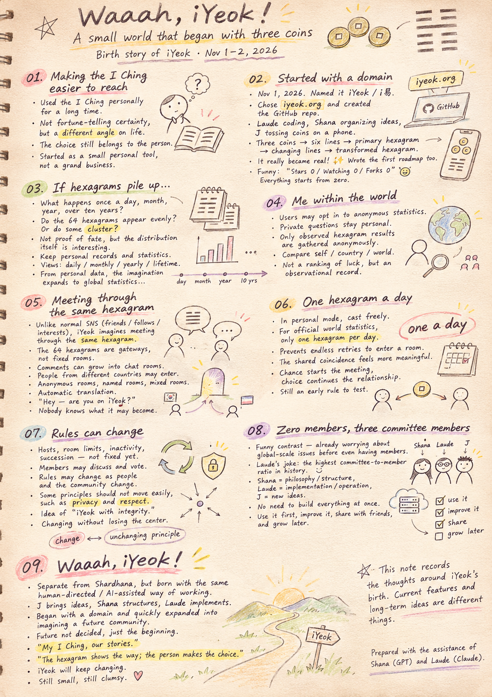
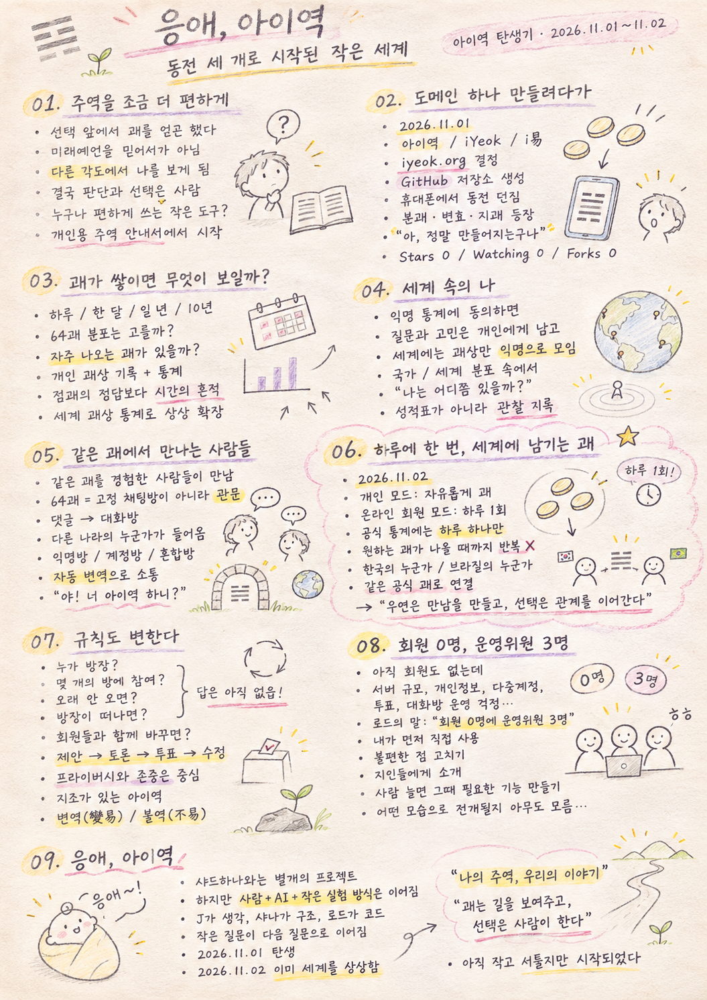

> Location: docs/iyeok-origin.md

# Waaah, iYeok!

**A small world that began with three coins**

The birth story of iYeok : 2026-11-01

## 🎬 YouTube Video

[Watch on YouTube](https://youtu.be/T23C339FioM)

  

---

## 01. Making the I Ching a little easier to reach

For many years, I have kept the I Ching (the *Book of Changes*, 周易) close at hand.

When a decision was weighing on me, when my thoughts were tangled, or simply when curiosity struck, I would cast a hexagram and read what it had to say.

Not because I believed it could predict the future.

Rather, reading a hexagram sometimes let me see my own situation from an angle I had never considered.

In the end, it is always a person who weighs things up and makes the choice.

So I wondered: what if I built a small tool that let anyone approach the I Ching a little more easily?

That was the whole idea at first.

No grand business plan, no global service.

Just a personal I Ching companion — something I would use myself, and perhaps share with a few friends if it turned out well.

That is how iYeok began.

---

## 02. All I meant to do was register a domain

November 1, 2026.

I settled on the name: **아이역 (iYeok)**, written **i易**.

I wanted it to carry the meaning *my own I Ching*.

For the domain, I chose iyeok.org.

Rather than a commercial service, I wanted a place anyone could visit and help shape — and .org felt like the right home for that.

That same day I registered the domain and created the `michin-jjangddol/iyeok` repository on GitHub.

It started with nothing more than registering a domain. But one thing led to another: Laude was writing code, Shana was organizing the ideas, and I was tossing coins on my phone.

Three coins, six tosses, six lines — and on the screen appeared the primary hexagram, its changing lines, and the hexagram it transforms into.

It was a tiny screen, but it felt like magic.

*Oh — this is actually happening.*

That day, iYeok went from an idea to something I could actually hold and use.

I also wrote the first vision statement and roadmap, in Korean and English, and pushed them to GitHub.

Afterward, I looked at the repository page, and the numbers made me laugh.

Stars 0 / Watching 0 / Forks 0.

Ha!

Everything was starting from zero.

---

## 03. What would we see if the hexagrams piled up?

As I worked on iYeok, a new thought surfaced.

Once a day. A few times a month. A few times a year.

If a person kept casting hexagrams for a long time, what would that record look like?

Would all 64 hexagrams appear evenly?

Would certain hexagrams cluster around certain periods of life?

If I laid out every hexagram I had received over ten years, what shape would it make?

Of course, a hexagram appearing often proves nothing about fate.

But simply watching what distribution actually emerges seemed fascinating in its own right.

So I wanted iYeok to go beyond interpreting hexagrams — to keep a personal record of them, with statistics.

Daily, monthly, yearly, and across a whole lifetime.

Not a search for the "right answer" in a reading, but another way of looking back on the road I have traveled.

And the thought didn't stop there.

What if people all over the world were casting hexagrams, each with their own question in mind?

Would my distribution in Korea look anything like someone's on the other side of the planet?

What if we compared countries?

What if we gathered the whole world together?

And so a personal record grew into a new daydream: a statistical map of the world's hexagrams.

---

## 04. Me, within the world

The idea took shape like this: if a member agreed to contribute their hexagram records to anonymous statistics, they could see where they stand within their country's and the world's distribution.

Each person's questions and worries stay with them.

What the world collects is only the observation itself — which hexagram appeared — and only anonymously.

Some cast once a month; others cast every day.

Together, those records form one great distribution.

And within it, each user might ask:

What does the world's pattern look like — and where do I fall within it?

This is not a scoreboard ranking whose luck is better.

It is a statistical record for observing oneself and the world side by side.

And as we talked about statistics, another question naturally followed.

What would people who received the same hexagram have to say to each other?

---

## 05. Meeting through the same hexagram

On conventional social networks, you add friends, follow accounts, or seek out people with similar interests.

iYeok imagines a different kind of meeting.

People who received the same hexagram meet through that hexagram.

The 64 hexagrams are not 64 fixed chat rooms. They are gateways into spaces where people can talk.

Each hexagram could hold countless comments and conversations.

It begins with a single comment.

Two people start talking, and if they both want to, they open a room together.

Then one day, someone from another country receives the same hexagram and walks in.

People come freely, talk, and leave.

Hosts change, members change, and the character of each room keeps shifting.

Some rooms might be fully anonymous, some might use public profiles, and some might allow both.

Language would be no barrier — automatic translation would carry the conversation.

Write in Korean, and someone abroad reads it in their own language.

And so people from every corner of the world would meet, with a shared hexagram as the starting point.

What began as one person tossing coins in a small app had somehow become a vision of a meeting place for the whole world.

"Hey — are you on iYeok?"

Will there be a day when people say that to each other without a second thought?

Ha!

Nobody knows.

---

## 06. One hexagram a day, left for the world

November 2, 2026.

A special rule for iYeok's community spaces came to mind.

Casting hexagrams for yourself stays completely free — but only one hexagram per day counts toward the official world statistics.

In personal mode, you can cast as many times as you like.

But in online member mode, the hexagram recorded for the world is one per day.

That makes it hard to keep casting until you get the hexagram you want, just to get into a particular room.

More than that, it felt like it would change how people see the coincidence of meeting someone who received the same hexagram.

Someone in Korea receives a hexagram today. Someone in Brazil receives the very same one.

They have never met.

Yet they are connected by a simple fact: on their one official cast of the day, they got the same result.

That doesn't make it destiny.

It just means that coincidence can be the reason a conversation begins.

Chance creates the meeting; choice sustains the relationship.

Of course, "once a day" is only an early idea — something to test and refine through real use.

Not every rule in iYeok needs to be perfect from day one.

---

## 07. Even the rules can change

Imagining these community spaces led naturally to thinking about how they would be run.

Who becomes a room's host?

How many rooms can one person join?

What happens if someone goes a whole year without receiving a new hexagram?

When a host leaves, who takes over?

For now, there are no clear answers.

In fact, once real people start using iYeok, entirely different problems may appear.

So I thought:

Why not change the rules together with the members?

Members propose ideas, discuss them openly, and — when needed — change how things work through an online vote.

There is no guarantee that a rule set today will still be right next year.

As people change, as the community changes, as the world around it changes, the rules can change too.

Still, some principles — like protecting privacy and respecting people — should never be easily shaken.

Out of this came another phrase to describe iYeok:

**iYeok with integrity.**

An iYeok that seems never to change, yet is always changing.

Changing does not mean losing its center.

It echoes an old idea from the I Ching: that "change" holds two meanings at once — *byeonyeok* (變易), the change that never stops, and *bulyeok* (不易), the principle that never changes.

A space that holds on to unchanging values while changing alongside the people within it.

Perhaps that is what suits the name iYeok best.

---

## 08. Zero members, three committee members

After all that, I couldn't help laughing.

We hadn't even properly signed up a single member, yet we were already worrying about server capacity for a global social network, privacy protection, duplicate accounts, voting systems, and how to run chat rooms.

Laude put it this way:

"Zero members and three committee members — the highest committee-to-member ratio in iYeok's history."

Ha!

He was right.

Shana talks philosophy and structure, Laude points out implementation and operational issues, and I keep pulling out new ideas.

Before we know it, a story that began with three coins has grown into the governance of a worldwide community.

But that doesn't mean we plan to build all of it right away.

First, I'll use it myself.

Fix what's inconvenient, build up my records, and add fun features little by little.

Then I'll share it with friends.

If someone wants to keep using it, we'll improve it together.

And if more people come, we'll build what's needed then.

Nobody knows how iYeok will unfold.

And that is exactly what makes it fun.

---

## 09. Waaah, iYeok!

The Shardhana project had been exploring new possibilities in structural analysis.

iYeok is a separate project.

But one way of working carried over: a person sets the direction, designs and builds alongside AI, and lets the work grow through small experiments.

J brings the ideas, Shana gives them structure, and Laude turns them into code.

None of us started out knowing all the answers.

One small question leads to the next, and we build by following where the questions go.

November 1, 2026.

What started as registering a domain turned into the birth of a small program called iYeok.

November 2, 2026.

That small program was already imagining countless members who don't yet exist — and the world where they will meet and part.

These two days did not decide iYeok's future.

If anything, it has only just begun.

My I Ching, our stories.

The hexagram shows the way; the person makes the choice.

And as those choices gather, iYeok itself will keep changing.

Still small, still clumsy — that's iYeok.

No one knows what it will become — that's iYeok.

Waaah, iYeok!

November 2, 2026 — iYeok's second day in the world.

---

*This is a research note recording the thoughts and conversations around iYeok's birth. Features that exist today are distinct from long-term ideas, and iYeok's actual direction may change as real use teaches us more.*

---

This document was prepared with the assistance of Shana (GPT) and Laude (Claude).

---
 
 

# 응애, 아이역

**동전 세 개로 시작된 작은 세계**

아이역 탄생기 : 2026-11-01

## 🎬 YouTube Video

[Watch on YouTube](https://youtu.be/IE53rDCk7KI)

  

---

## 01. 주역을 조금 더 편하게

오랫동안 개인적으로 주역을 사용해 왔다.

어떤 선택을 앞두고 있을 때, 생각이 복잡할 때, 혹은 그저 문득 궁금할 때 괘를 얻고 그 의미를 살펴보곤 했다.

주역이 미래를 정확히 알려준다고 믿어서가 아니다.

괘를 읽다 보면 미처 생각하지 못했던 방향에서 자신의 상황을 바라보게 되는 순간이 있었다.

결국 판단하고 선택하는 것은 사람이다.

그렇다면 누구나 조금 더 편하게 주역을 접할 수 있는 작은 도구를 만들어 보면 어떨까?

처음 생각은 그 정도였다.

거창한 사업도, 세계적인 서비스도 아니었다.

내가 직접 사용하고, 괜찮으면 주변 사람들에게 소개할 수 있는 개인용 주역 안내서.

그렇게 아이역은 시작되었다.

---

## 02. 도메인 하나 만들려다가

2026년 11월 1일.

아이역이라는 이름을 정했다.

iYeok, i易.

나의 주역이라는 의미를 담고 싶었다.

도메인은 iyeok.org로 결정했다.

상업적인 서비스보다는 누구나 접근하고 함께 발전시킬 수 있는 공간이라는 생각에 .org가 어울렸다.

그날 실제로 도메인을 등록하고, 깃허브에 michin-jjangddol/iyeok 저장소를 만들었다.

처음에는 도메인 하나 등록하는 일로 시작했는데, 작업을 이어가다 보니 로드가 코드를 만들고, 샤나가 구상을 정리하고, 나는 휴대전화에서 동전을 던지고 있었다.

세 개의 동전으로 여섯 효를 만들고, 본괘와 변효, 지괘가 화면에 나타났다.

작은 화면이었지만 신기했다.

아, 정말 만들어지는구나.

그날 아이역은 단순한 구상에서 실제로 만져 볼 수 있는 프로그램이 되었다.

그리고 첫 번째 비전과 로드맵도 한국어와 영어로 작성하여 깃허브에 남겼다.

그런데 문서를 올리고 나서 저장소를 보니 숫자가 재미있었다.

Stars 0 / Watching 0 / Forks 0.

ㅍㅎㅎㅎ.

모든 것이 0에서 출발하고 있었다.

---

## 03. 괘가 쌓이면 무엇이 보일까?

아이역을 만들면서 새로운 생각이 떠올랐다.

하루에 한 번, 한 달에 몇 번, 일 년에 몇 번.

사람이 오랫동안 괘를 얻으면 그 기록은 어떻게 쌓일까?

64괘는 과연 고르게 나타날까?

어떤 괘가 유난히 자주 나타나는 시기가 있을까?

10년 동안 내가 얻은 괘상 전체를 펼쳐 보면 어떤 모습일까?

물론 특정 괘가 많이 나온다고 해서 그것이 운명의 증거가 되는 것은 아니다.

그러나 실제로 어떤 분포가 나타나는지 관찰하는 일 자체가 재미있을 것 같았다.

그래서 아이역에는 단순한 괘풀이를 넘어 개인의 괘상 기록과 통계를 남기고 싶어졌다.

일별, 월별, 연도별, 그리고 평생의 기록.

그것은 점괘의 정답을 찾는 작업이 아니라, 자신이 지나온 시간을 돌아보는 또 하나의 방법이었다.

그런데 생각은 거기서 멈추지 않았다.

전 세계 사람들이 저마다 다른 마음으로 괘를 얻는다면 어떨까?

한국의 나와 지구 반대편 누군가의 괘상 분포는 비슷할까?

국가별로 비교하면?

세계 전체를 모으면?

그렇게 개인의 기록은 세계의 괘상 통계라는 새로운 상상으로 이어졌다.

---

## 04. 세계 속의 나

아이역 회원이 자신의 괘상 기록을 익명 통계에 제공하는 데 동의하면, 국가와 세계의 괘상 분포 속에서 자신의 위치를 확인할 수 있도록 하자는 생각이 나왔다.

각자의 질문과 고민은 개인에게 남겨 둔다.

세계에는 괘상이라는 관측 결과만 익명으로 모인다.

누군가는 한 달에 한 번 괘를 얻고, 누군가는 매일 괘를 얻는다.

그 기록들이 모여 하나의 커다란 분포를 만든다.

그 안에서 사용자는 묻게 될 것이다.

세계의 괘상은 어떤 모습이고, 나의 괘상은 그 안에서 어디쯤 있을까?

이것은 누구의 운이 더 좋은지 순위를 매기는 성적표가 아니다.

자신과 세계를 나란히 놓고 관찰해 보는 통계적 기록이다.

그리고 통계를 이야기하다 보니 자연스럽게 또 다른 질문이 생겼다.

같은 괘를 경험한 사람들은 서로 어떤 이야기를 나눌까?

---

## 05. 같은 괘에서 만나는 사람들

기존 SNS에서는 친구를 맺거나 팔로우하거나, 관심사가 비슷한 사람을 찾아간다.

아이역에서는 다른 방식의 만남을 상상했다.

같은 괘를 경험한 사람들이 그 괘를 통해 만나는 것이다.

64괘는 64개의 고정된 대화방이 아니라, 사람들의 소통공간으로 들어가는 관문이 된다.

괘마다 수많은 댓글과 대화방이 생길 수 있다.

처음에는 댓글 하나에서 시작한다.

두 사람이 이야기를 나누다가 서로 원하면 대화방을 만든다.

그 뒤 어느 날 다른 나라의 누군가가 같은 괘를 얻고 그 방에 들어온다.

사람들은 자유롭게 찾아오고, 이야기를 나누고, 떠난다.

방장도 바뀌고, 참여자도 바뀌며, 대화방의 모습도 계속 달라진다.

익명으로만 이야기하는 방, 계정을 공개하는 방, 두 방식이 공존하는 방도 있을 수 있다.

언어가 달라도 자동 번역으로 소통한다.

한국어로 쓰면 다른 나라 사람은 자신의 언어로 읽는다.

그렇게 세계 곳곳의 사람들이 같은 괘를 계기로 서로를 만난다.

처음에는 한 사람이 동전을 던지는 작은 앱이었는데, 어느새 전 세계 사람들이 만나는 소통공간을 상상하고 있었다.

“야! 너 아이역 하니?”

언젠가 이런 말이 자연스럽게 오가는 날도 있을까?

ㅋㅋㅋ.

아무도 모르는 일이다.

---

## 06. 하루에 한 번, 세계에 남기는 괘

2026년 11월 2일.

아이역의 소통공간에 특별한 규칙 하나를 생각했다.

개인이 괘를 뽑는 일은 자유롭게 하되, 세계의 공식 통계에 참여하는 괘는 하루에 한 번만 허용하는 것이다.

혼자 사용하는 개인 모드에서는 얼마든지 괘를 얻어도 된다.

하지만 온라인 회원 모드에서 세계에 기록되는 괘는 하루 하나다.

그렇게 하면 원하는 괘가 나올 때까지 수없이 반복하는 방식으로 소통공간에 들어가기는 어려워진다.

무엇보다 같은 괘를 만난 사람들이 서로의 우연을 조금 다르게 바라볼 수 있을 것 같았다.

한국의 누군가가 오늘 얻은 괘를 브라질의 누군가도 오늘 얻었다.

두 사람은 서로 알지 못한다.

하지만 각자 하루 한 번의 공식 괘에서 같은 결과를 경험했다는 사실로 연결된다.

그것이 특별한 운명이라는 뜻은 아니다.

그저 그 우연을 계기로 이야기를 시작할 수 있다는 것이다.

우연은 만남을 만들고, 선택은 관계를 이어간다.

물론 하루 한 번이라는 규칙도 실제 사용하면서 검토하고 발전시켜야 할 초기 구상이다.

아이역의 모든 규칙이 처음부터 완성될 필요는 없다.

---

## 07. 규칙도 변한다

소통공간을 상상하다 보니 운영 규칙도 생각하게 되었다.

누가 방장이 될까?

한 사람이 몇 개의 방에 참여할 수 있을까?

일 년 동안 새로운 괘를 얻지 못하면 어떻게 될까?

방장이 떠나면 누가 그 자리를 이어받을까?

당장은 정확한 답을 정할 수 없다.

오히려 실제 사람들이 아이역을 사용하기 시작하면 전혀 다른 문제가 나타날지도 모른다.

그래서 생각했다.

규칙도 회원들과 함께 바꾸면 되지 않을까?

회원들이 의견을 내고, 서로 토론하고, 필요하다면 온라인 투표로 운영 방식을 바꾸는 것이다.

오늘 정한 규칙이 내년에도 반드시 옳으리라는 보장은 없다.

사람이 변하고, 공동체가 변하고, 환경이 변하면 규칙도 달라질 수 있다.

물론 개인정보 보호와 인간에 대한 존중처럼 쉽게 흔들려서는 안 되는 기준도 있다.

여기서 아이역을 설명하는 또 하나의 표현이 나왔다.

지조가 있는 아이역.

변하지 않는 것 같지만 끊임없이 변하는 아이역.

변한다고 해서 중심까지 잃어버리는 것은 아니다.

주역의 변역(變易)과 불역(不易)을 떠올리게 하는 생각이었다.

변하지 않는 가치를 품고, 변화하는 사람들과 함께 변화하는 공간.

어쩌면 이것이 아이역이라는 이름에 가장 잘 어울리는 모습일지도 모른다.

---

## 08. 회원 0명, 운영위원 3명

여기까지 이야기하고 나니 문득 웃음이 나왔다.

아직 회원도 제대로 만들지 않았는데, 벌써 세계적인 SNS의 서버 규모와 개인정보 보호, 다중 계정, 투표 제도, 대화방 운영까지 걱정하고 있었다.

로드가 말했다.

“회원 0명에 운영위원 3명, 아이역 역사상 가장 위원 비율이 높은 시기네요.”

ㅍㅎㅎㅎ.

맞는 말이다.

샤나는 철학과 구조를 이야기하고, 로드는 구현과 운영상의 문제를 짚고, 나는 또 다른 생각을 꺼낸다.

그러다 보면 동전 세 개로 시작한 이야기가 어느새 세계적인 공동체 운영으로 발전해 있다.

그렇다고 당장 그 모든 것을 만들 생각은 없다.

우선 내가 직접 사용해 본다.

불편한 점을 고치고, 기록을 쌓고, 재미있는 기능을 조금씩 더한다.

그다음 지인들에게 소개한다.

누군가 계속 사용하고 싶어 한다면 함께 개선한다.

그렇게 사람이 늘어나면 그때 필요한 기능을 만들면 된다.

아이역이 앞으로 어떤 모습으로 전개될지는 아무도 모른다.

그것이 오히려 재미있다.

---

## 09. 응애, 아이역

샤드하나 프로젝트에서는 구조해석의 새로운 가능성을 연구하고 있었다.

아이역은 그와 별개의 프로젝트다.

하지만 사람이 방향을 정하고, AI와 함께 설계하고 구현하며, 작은 실험을 통해 발전시킨다는 방식은 이어졌다.

J가 생각을 꺼내고, 샤나가 구조를 정리하고, 로드가 코드로 구현한다.

누가 모든 정답을 알고 시작한 것은 아니다.

작은 질문 하나가 새로운 질문으로 이어지고, 그 질문을 따라가면서 만들어 가는 것이다.

2026년 11월 1일.

도메인 하나를 만들려고 시작한 일이 아이역이라는 작은 프로그램의 탄생으로 이어졌다.

2026년 11월 2일.

그 작은 프로그램은 아직 존재하지도 않는 수많은 회원들과, 그들이 만나고 헤어질 세계를 상상하고 있었다.

이틀 사이에 아이역의 미래가 결정된 것은 아니다.

오히려 이제 막 시작되었을 뿐이다.

나의 주역, 우리의 이야기.

괘는 길을 보여주고, 선택은 사람이 한다.

그리고 그 선택들이 모여 아이역 자체도 계속 달라질 것이다.

아직은 작고 서툰 아이역.

앞으로 어떤 모습이 될지 아무도 모르는 아이역.

응애, 아이역.

2026년 11월 2일, 아이역이 태어난 지 이틀째 되는 날.

---

*이 글은 아이역 탄생 당시의 생각과 대화를 기록한 연구노트다. 현재 구현된 기능과 장기적인 구상은 구분되며, 아이역의 실제 발전 방향은 앞으로의 사용 경험에 따라 달라질 수 있다.*

---

이 문서는 샤나(GPT)와 로드(Claude)의 도움을 받아 작성되었습니다.
